# JibuCloud — Something happens. AWS responds.

JibuCloud is a beginner workshop demonstrating an event-driven assignment-submission workflow built on AWS.

---

## What happens?

1. A student uploads a file to an Amazon S3 bucket.
2. S3 sends an Object Created event to Amazon EventBridge.
3. EventBridge matches the event and fans it out to two independent targets:
   - Amazon SNS sends an email notification to the subscribed lecturer.
   - Amazon SQS stores a work message for asynchronous processing.
4. The Lambda event source mapping polls SQS and invokes the Lambda function.
5. Lambda logs the assignment bucket, object key, and event time to CloudWatch Logs.

**Important:** JibuCloud does not grade assignments. It demonstrates event detection, routing, notification, buffering, and processing.

---

## Architecture

```text
Student
  |
  | upload file
  v
Amazon S3
  |
  | Object Created event
  v
Amazon EventBridge
  |                         |
  |                         |
  v                         v
Amazon SNS                 Amazon SQS
  |                         |
  | email                   | event source mapping polls
  v                         v
Lecturer inbox             AWS Lambda
                              |
                              v
                       CloudWatch Logs
```

---

## Prerequisites

- Terraform 1.5 or later
- AWS CLI configured with credentials for a workshop AWS account
- Permission to create S3, EventBridge, SNS, SQS, Lambda, IAM, and CloudWatch resources
- An email address you can access to confirm the SNS subscription

Use a dedicated learning account. Do not use real student records or confidential assignment files.

---

## Option A — Deploy with Terraform (Instructor path)

From the `terraform` directory:

```powershell
cp terraform.tfvars.example terraform.tfvars
```

Edit `terraform.tfvars` and set `notification_email` to an inbox you can access.

Then run:

```powershell
terraform init
terraform fmt -recursive
terraform validate
terraform plan
terraform apply
```

Type `yes` when Terraform asks for confirmation.

Terraform creates a uniquely named bucket. Get its name:

```powershell
terraform output submission_bucket_name
```

### Confirm the SNS email subscription

Open the inbox configured in `notification_email` and click **Confirm subscription** in the AWS SNS email. Until confirmed, SNS cannot deliver notifications to that address.

Allow a few minutes after enabling S3 EventBridge notifications before testing the first upload.

---

## Option B — Build manually from the AWS Console (Student path)

For students who want to repeat the build after the session and understand each service individually.

### Step 1 — Create the S3 bucket

**S3 → Buckets → Create bucket**

- Set a globally unique bucket name (e.g. `jibucloud-yourname-submissions`)
- Choose your AWS Region and keep it consistent across all resources
- Keep **Block all public access** enabled
- Enable **Server-side encryption** using SSE-S3 (AES-256)
- After the bucket is created, go to **Properties → Amazon EventBridge** and turn on **Send notifications to Amazon EventBridge**

This last step is critical. Without it, S3 will not publish Object Created events to EventBridge and nothing downstream will trigger.

---

### Step 2 — Create the SNS topic

**SNS → Topics → Create topic**

- Choose **Standard** type
- Give it a name (e.g. `jibucloud-lecturer-notifications`)
- After creation, click **Create subscription**
  - Protocol: **Email**
  - Endpoint: your email address
- Open your inbox and click **Confirm subscription** in the email from AWS

Until the subscription is confirmed, SNS will not deliver any emails. This is a common point of confusion — confirm it before testing.

---

### Step 3 — Create the SQS queue

**SQS → Create queue**

- Choose **Standard** queue
- Give it a name (e.g. `jibucloud-submission-work`)
- Set **Visibility timeout** to **180 seconds**
- Set **Message retention period** to **4 days**
- Set **Receive message wait time** to **10 seconds** (enables long polling)
- Leave the access policy as default for now — you will update it in Step 6

---

### Step 4 — Create the Lambda function

**Lambda → Functions → Create function**

- Choose **Author from scratch**
- Function name: e.g. `jibucloud-processor`
- Runtime: **Python 3.12**
- Architecture: x86_64
- Under **Permissions**, choose **Create a new role with basic Lambda permissions**
- Click **Create function**
- In the **Code** tab, replace the default code with the contents of `lambda/handler.py` from this repository
- Click **Deploy**

---

### Step 5 — Configure IAM permissions

**IAM → Roles → find the role created for your Lambda function**

Lambda needs two sets of permissions:

**Permission 1 — Write logs to CloudWatch**

Attach an inline policy or use the managed policy `AWSLambdaBasicExecutionRole` (already attached if you used the default role creation). This allows Lambda to create log streams and put log events.

**Permission 2 — Poll and consume the SQS queue**

Add an inline policy with these actions on your SQS queue ARN:
- `sqs:ReceiveMessage`
- `sqs:DeleteMessage`
- `sqs:GetQueueAttributes`

**Permission 3 — Allow EventBridge to publish to SNS**

Go to **SNS → your topic → Edit → Access policy** and add a statement:

```json
{
  "Effect": "Allow",
  "Principal": { "Service": "events.amazonaws.com" },
  "Action": "sns:Publish",
  "Resource": "<your-sns-topic-arn>",
  "Condition": {
    "ArnEquals": {
      "aws:SourceArn": "<your-eventbridge-rule-arn>"
    }
  }
}
```

**Permission 4 — Allow EventBridge to send messages to SQS**

Go to **SQS → your queue → Access policy → Edit** and add a statement:

```json
{
  "Effect": "Allow",
  "Principal": { "Service": "events.amazonaws.com" },
  "Action": "sqs:SendMessage",
  "Resource": "<your-sqs-queue-arn>",
  "Condition": {
    "ArnEquals": {
      "aws:SourceArn": "<your-eventbridge-rule-arn>"
    }
  }
}
```

---

### Step 6 — Create the EventBridge rule

**EventBridge → Rules → Create rule**

- Name: e.g. `jibucloud-s3-object-created`
- Event bus: **default**
- Rule type: **Rule with an event pattern**
- Event source: **AWS events or EventBridge partner events**
- Event pattern:
  - AWS service: **S3**
  - Event type: **Amazon S3 Event Notification** → **Object Created**
  - Specific bucket: enter your bucket name
- Click **Next** and add two targets:

**Target 1 — SNS**
- Target type: **AWS service**
- Select: **SNS topic**
- Choose your SNS topic

**Target 2 — SQS**
- Click **Add another target**
- Target type: **AWS service**
- Select: **SQS queue**
- Choose your SQS queue

- Click through to review and **Create rule**

---

### Step 7 — Configure the Lambda SQS event source mapping

**Lambda → your function → Configuration → Triggers → Add trigger**

- Source: **SQS**
- SQS queue: select your queue
- Batch size: **5**
- Batch window: **5 seconds**
- Enable **Report batch item failures**
- Click **Add**

This wires Lambda to the queue. Lambda will now poll the queue automatically and invoke your function when messages arrive.

---

### Step 8 — Verify the EventBridge rule targets

**EventBridge → Rules → your rule → Targets tab**

Confirm both targets are listed:
- SNS topic
- SQS queue

Check that the rule status is **Enabled**. If permissions were not set correctly in Step 5, EventBridge will show delivery failures in its metrics.

---

## System Testing — Step by Step

Run these tests in order. Each step verifies one layer of the pipeline before moving to the next. All commands are written for Windows PowerShell.

---

### Test 1 — Confirm Terraform deployed successfully and get the bucket name

From the `terraform` directory, run:

```powershell
terraform output
```

You should see all outputs printed: bucket name, SNS ARN, SQS URL, Lambda function name, log group, and region.

To get just the bucket name:

```powershell
terraform output -raw submission_bucket_name
```

**What this confirms:** Terraform applied successfully and all resources were created. The bucket name contains the random suffix that makes it globally unique.

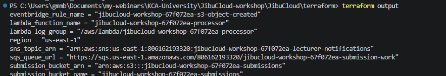

---

### Test 2 — Verify EventBridge notifications are enabled on the S3 bucket

Run this command to check the bucket notification configuration:

```powershell
aws s3api get-bucket-notification-configuration --bucket (terraform output -raw submission_bucket_name)
```

You should see `EventBridgeConfiguration` in the response, confirming S3 is publishing events to EventBridge.

You can also verify in the console: **S3 → your bucket → Properties → Amazon EventBridge → On**

**What this confirms:** S3 will publish Object Created events to EventBridge. Without this, the entire pipeline is silent.

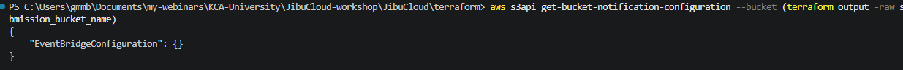

---

### Test 3 — Confirm the SNS email subscription

Run this to check the subscription status:

```powershell
aws sns list-subscriptions-by-topic --topic-arn (terraform output -raw sns_topic_arn)
```

Look for `"SubscriptionArn"` — if it shows a full ARN (not `PendingConfirmation`), the subscription is confirmed.

**What this confirms:** the lecturer will actually receive emails. A `PendingConfirmation` status means emails will be silently dropped.

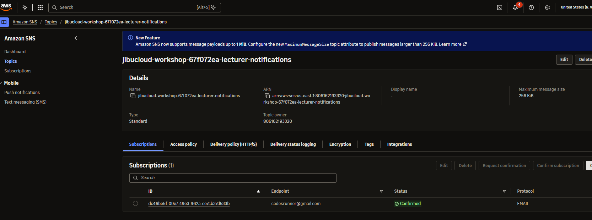

---

### Test 4 — Verify the EventBridge rule and both targets

Check the rule exists:

```powershell
aws events describe-rule --name (terraform output -raw eventbridge_rule_name)
```

Check both targets are attached:

```powershell
aws events list-targets-by-rule --rule (terraform output -raw eventbridge_rule_name)
```

You should see two targets in the response — one pointing to the SNS topic ARN and one pointing to the SQS queue ARN.

**What this confirms:** EventBridge knows what to listen for and has both delivery paths configured.

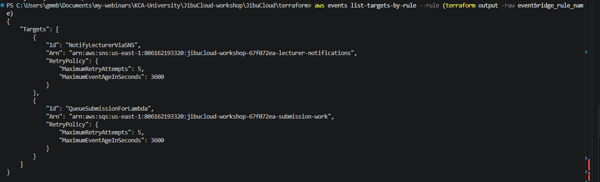

---

### Test 5 — Verify Lambda is connected to the SQS queue

In the console go to **Lambda → your function → Configuration → Triggers** and confirm the SQS queue is listed as a trigger with status **Enabled**.

Or run:

```powershell
aws lambda list-event-source-mappings --function-name (terraform output -raw lambda_function_name)
```

Look for `"State": "Enabled"` and confirm the `EventSourceArn` matches your SQS queue.

**What this confirms:** the event source mapping is active and Lambda will poll the queue automatically.

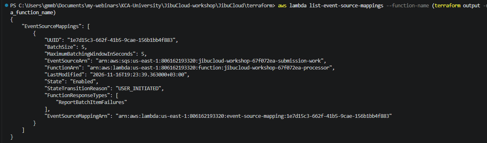

---

### Test 6 — Upload the first test file

Make sure you are in the `terraform` directory, then run:

```powershell
aws s3 cp assignment-test.txt "s3://$(terraform output -raw submission_bucket_name)/submissions/assignment-test.txt"
```

Confirm the upload succeeded — the CLI will print the source and destination path.

**What this confirms:** you can write to the bucket and the Object Created event will fire.

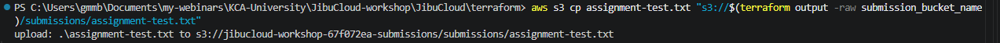

---

### Test 7 — Verify the file exists in S3

```powershell
aws s3 ls "s3://$(terraform output -raw submission_bucket_name)/submissions/"
```

You should see `assignment-test.txt` listed with its size and upload timestamp.

**What this confirms:** the file landed in the correct prefix inside the bucket.

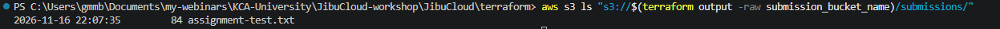

---

### Test 8 — Check the lecturer received the SNS email

Open the inbox you configured in `notification_email`. You should have received an email from AWS Notifications with subject **Amazon S3 Notification** containing the full EventBridge event JSON, including:
- `source`: `aws.s3`
- `detail-type`: `Object Created`
- `bucket.name`: your bucket name
- `object.key`: `submissions/assignment-test.txt`

**What this confirms:** S3 → EventBridge → SNS → email is working end to end.

If no email arrives:
- Confirm the SNS subscription is not in `PendingConfirmation` state
- Check the SNS topic access policy allows `events.amazonaws.com` to publish
- Check EventBridge rule metrics for failed invocations

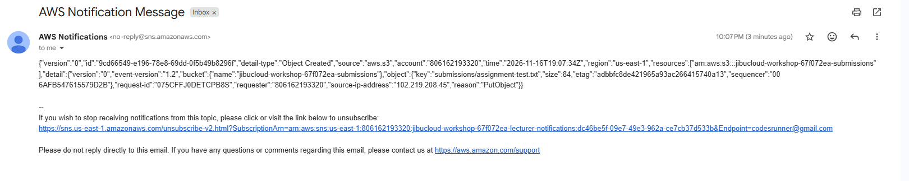

---

### Test 9 — Check CloudWatch SQS metrics

Go to **CloudWatch → Metrics → SQS → your queue** and look at:
- **NumberOfMessagesSent** — should show a spike at the time of upload
- **NumberOfMessagesDeleted** — should match, confirming Lambda consumed and deleted the message

Or check directly in the SQS console: **SQS → your queue → Monitoring tab**

**What this confirms:** EventBridge delivered the message to SQS and Lambda consumed it successfully.

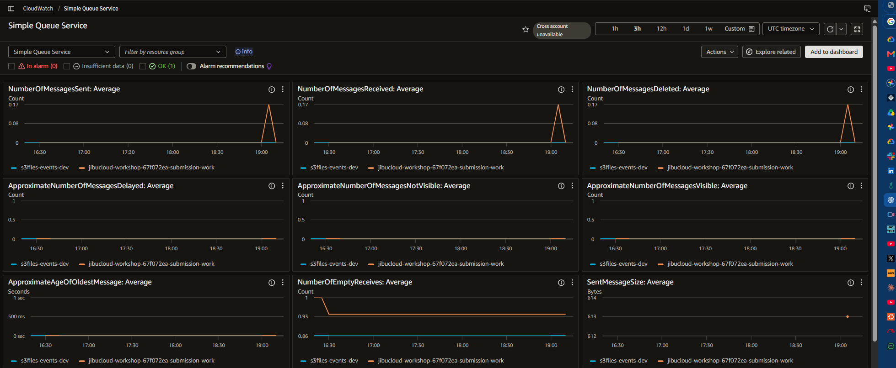

---

### Test 10 — Check CloudWatch Lambda metrics

Go to **Lambda → your function → Monitor tab** or run:

```powershell
aws logs tail "$(terraform output -raw lambda_log_group)" --since 10m --follow
```

In the console look for:
- **Invocations** — at least 1
- **Errors** — 0
- **Duration** — well under the 20-second timeout

**What this confirms:** the SQS event source mapping triggered Lambda and the function ran without errors.

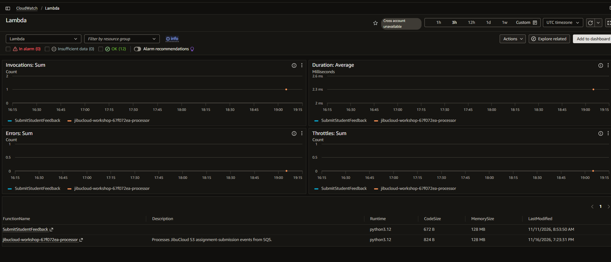

---

### Test 11 — Read the structured log in CloudWatch

Go to **CloudWatch → Log groups** and open the log group:

```powershell
terraform output lambda_log_group
```

Or tail it live from the terminal:

```powershell
aws logs tail "$(terraform output -raw lambda_log_group)" --since 10m --follow
```

Open the most recent log stream and find the structured JSON log line. It should look like:

```json
{
  "message": "JibuCloud received a new assignment submission",
  "event_name": "Object Created",
  "bucket": "jibucloud-workshop-xxxx-submissions",
  "object_key": "submissions/assignment-test.txt",
  "event_time": "2025-01-01T12:00:00Z"
}
```

**What this confirms:** Lambda successfully parsed the SQS message, extracted the event details, and logged them. The full pipeline — S3 → EventBridge → SQS → Lambda → CloudWatch — is working end to end.

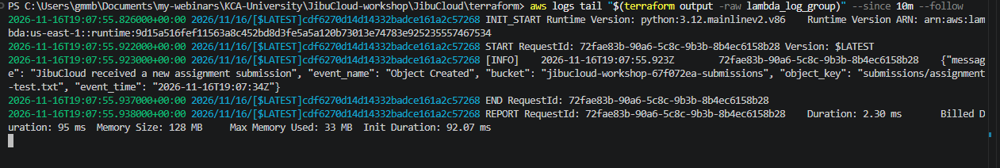

---

### Test 12 — Upload a file with spaces in the name

```powershell
aws s3 cp "my assignment test.txt" "s3://$(terraform output -raw submission_bucket_name)/submissions/my%20assignment%20test.txt"
```

Then tail the logs:

```powershell
aws logs tail "$(terraform output -raw lambda_log_group)" --since 5m
```

Confirm the `object_key` in the log shows `my assignment test.txt` (decoded), not `my%20assignment%20test.txt`.

**What this confirms:** the Lambda function correctly URL-decodes object keys that contain spaces or special characters using `unquote_plus`. This matters because S3 URL-encodes object keys in events.

---

### Test 13 — Upload a second assignment and confirm the pipeline runs again

```powershell
aws s3 cp assignment-test-2.txt "s3://$(terraform output -raw submission_bucket_name)/submissions/assignment-test-2.txt"
```

Check your inbox for a second notification email and check CloudWatch Logs for a second structured log entry.

**What this confirms:** the pipeline is stateless and handles every new upload independently. Each submission triggers its own full event chain.

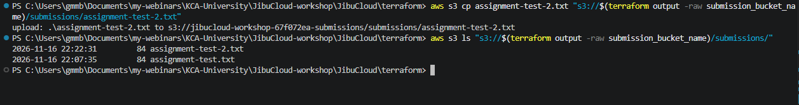

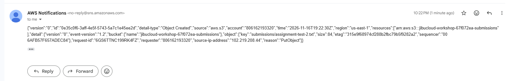

---

### Test 14 — List all uploaded files in the bucket

```powershell
aws s3 ls "s3://$(terraform output -raw submission_bucket_name)/submissions/"
```

You should see all files uploaded during the session listed with their sizes and timestamps.

**What this confirms:** all submissions are durably stored in S3 and can be listed or retrieved at any time.

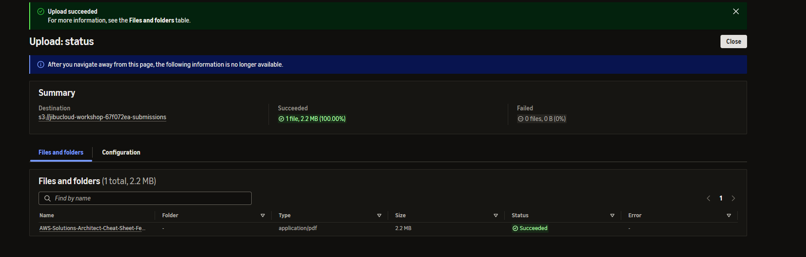

---

## Cleanup

List the bucket contents first:

```powershell
aws s3 ls "s3://$(terraform output -raw submission_bucket_name)" --recursive
```

Remove all uploaded files:

```powershell
aws s3 rm "s3://$(terraform output -raw submission_bucket_name)" --recursive
```

If Terraform state is no longer available, use the actual bucket name directly:

```powershell
aws s3 rm s3://<your-bucket-name> --recursive
```

Then destroy all infrastructure:

```powershell
terraform destroy
```

Review the plan and type `yes`.

The bucket is deliberately **not** configured for automatic deletion of its contents. Always empty it before running `terraform destroy`.

---

## Cost and safety notes

This workshop uses managed AWS services that can incur charges even at low usage. Keep the demo short, use a dedicated learning account, check current pricing for your Region, and destroy all resources after the session. Do not upload sensitive, personal, or confidential data.
